<!-- generated by scripts/build.py from profile.json -->

<h3><code>~/jeet $ ./contributions.sh</code></h3>

  

<h3><code>~/jeet $ whoami</code></h3>

<table>
  <tr>
    <td valign="top"></td>
    <td valign="top"></td>
  </tr>
</table>

 

<h3><code>~/jeet $ ./snake --eat contributions</code></h3>

<picture>
  <source media="(prefers-color-scheme: dark)" srcset="https://raw.githubusercontent.com/jeetron1x/jeetron1x/output/github-snake-dark.svg"/>
  <source media="(prefers-color-scheme: light)" srcset="https://raw.githubusercontent.com/jeetron1x/jeetron1x/output/github-snake.svg"/>
  
</picture>

  

<h3><code>~/jeet $ ./links.sh</code></h3>

<b>CS Student @ ITER, Bhubaneswar · Aspiring Full-Stack Developer</b>

 

